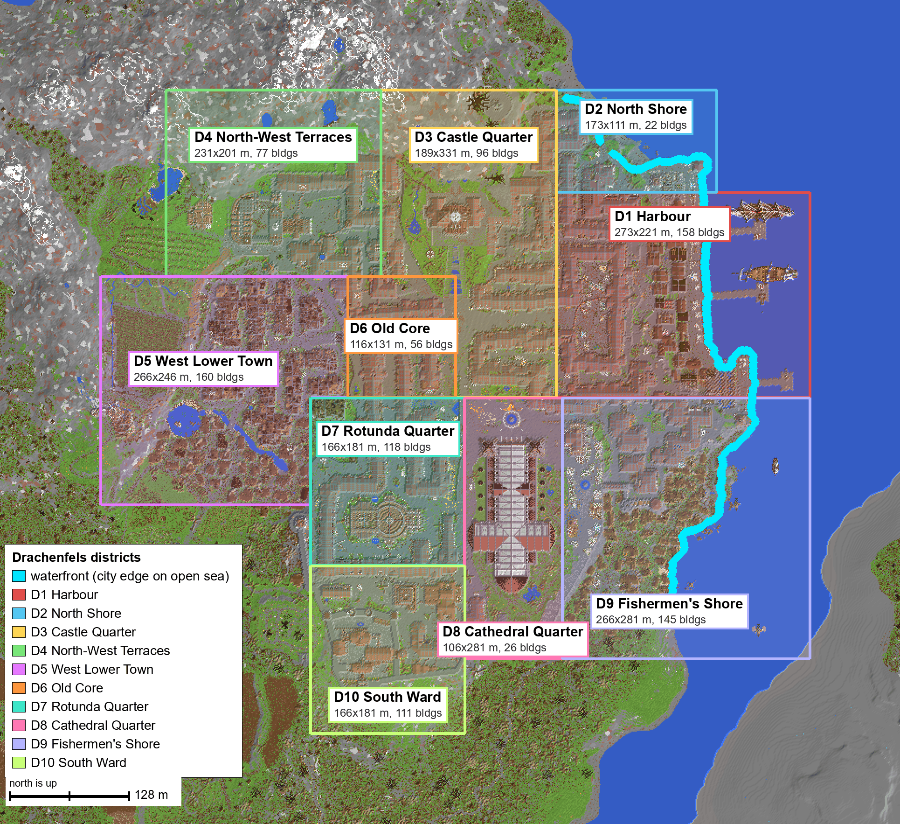

# Drachenfels survey (Track B1, job 1)

> **Erratum (2026-11-13, found by Track B1 job 2).** The survey's palette reader dropped every 26.x block state that
> is not a block's default: 26.3 writes those as `{id, properties}`, the reader expected `{Name, Properties}`, so
> stairs, slabs, doors, fences, beds, sideways logs and the like were read as **air**. The building outlines here
> still hold up, because the walls and roofs are mostly full blocks, and the D1 decision stands: re-measured with
> the fix, D1 has 160 buildings, 131 homes and workplaces, and its height range is y 34–140. But counts of doors
> (271 → 3,973), beds and workstations, and the building split in the dense core (D6, D7, D10), change a lot. The
> splitter's thresholds were tuned on the faulty data, so re-running the survey as it stands merges many terraces.
> The reader is fixed in `tools/buildimport` (`anvil.block_key`). The catalog and figures below are left as they
> were; the building map behind the catalog is frozen in `labels.npz`, so catalog ids stay valid. Re-tuning the
> survey on correct data is a follow-up.

**In short:**
- Drachenfels is a coastal city with mountains to the north, farmland and forest to the west and south, and open sea along its whole east side. Its built core is about **760 × 665 blocks** (0.29 km²) and holds roughly **1,000 buildings**.
- It splits cleanly along its streets into **10 districts**.
- For v0.1 I recommend **D1 Harbour**: the quay, three piers and moored ships. It is the first stage of the coastal city, and the rest of the city joins onto it on three sides.
- Planner footprint for the Harbour: **272 × 224 blocks, waterfront on the east side, required**, with the east 112 blocks being sea and piers.
- Many buildings are tall hollow shells. There is a lot of room inside them for NPCs to add floors later.

Nothing was extracted or changed. The save was only read.

*North is up; x grows east, z grows south. All coordinates are the save's own block coordinates.*

---

## 1. What is in the save
- **The real map:** the area of chunks that came from the original 2019 map, x −496…527, z −1520…−385, about 1,024 × 1,136 blocks.
- **Around it:** a ring of flat land that Minecraft 26.3 generated when the save was opened, with a few vanilla villages. The tool ignores that ring automatically, along with 364 unconverted 1.12 chunks that are only flat dirt and grass.
- **Sea level:** y 66 (ours is 63, so the city is placed 3 blocks lower).
- **City outline** (built-up area with its streets and courtyards): x −372…387, z −1352…−688, **760 × 665 blocks, 288,900 m²**, of which 236,200 m² is built.
- **Everything built, outlying farms and huts included:** x −489…504, z −1495…−496.
- **Heights:**
  - roofs: median y 118, highest y 235 (cathedral spire)
  - streets: from y ≈ 72 at the quay to ≈ 100–135 inland, and up to ≈ 190 on the castle hill under the mountain
  - per-column floor cut-off: half the built columns start right on the ground; 5% reach 27 or more blocks below it (cellars, foundations); the deepest goes 128 below, to y 5
- **Furnishing:**
  - interiors are mostly bare: the whole map has only 161 bed blocks, about 135 doors and 2,300 workstation blocks
  - item frames, paintings and armour stands are entities and weren't read

Images: [height.png](height.png) (surface height) · [density.png](density.png) (how much is built per spot).

## 2. The coast
- **Which side meets water:** the **east**.
  - Seen from the city's middle, the nearby sea lies 44% to the north-east, 27% east and 20% south-east, with none to the west.
  - North is mountains; west and south are farms and forest.
  - Across a 100–250-block strait to the south-east lies a bare stone landmass that is not part of the city.
- **How far the waterfront runs:**
  - **777 m of the city's edge lies on open sea**, about a third of its 2.4 km outline.
  - It runs about 560 blocks north–south (z −1351…−793) and bends north-east at its northern end.
  - It has three parts:
    - the harbour quay with its basin (D1, ~290 m)
    - the North Shore terraces (D2, ~210 m)
    - the Fishermen's Shore beach (D9, ~290 m)
- **Piers:** three piers with moored ships reach **up to 98 blocks** out from the city edge.
- **Water depth** below sea level:
  - 13 blocks typical within 16 blocks of the shore (5–19)
  - 14 blocks out to 96 blocks
  - 15 blocks out to 160 blocks
  - the harbour basin is deeper, 14–28 blocks (typically about 22)

**What a planner needs from our coastline to seat the full city:**
1. Sea on one side of the site. The city's sea side is its east side; rotation can turn it to face any compass side.
2. A fairly straight shoreline at least ~600 blocks long, bending slightly at one end.
3. Open sea at least ~100 blocks out from the shore (piers and ships), ideally 160 so ships have room.
4. Depth of about 10 or more right at the shore. The district templates bring their own harbour floor, so deeper water is fine and shallower water gets dug out by the blend.
5. A land site of about 760 × 665 blocks plus ~40 blocks of ground and blend margin, so ~840 × 745.

The whole city therefore does not fit on the 1,024 × 1,024 v0.1 island alongside wilderness and a POI. It waits for the larger world (5k+), as already planned.

Image: [water.png](water.png) (sea depth, waterfront in yellow).

## 3. Districts
The cuts follow the city's own seams ([seams.png](seams.png)):
- the north–south avenue from the castle to the fountain square (x ≈ 20)
- the cross street at the fountain square (z ≈ −1030)
- the street behind the harbour (x ≈ 128)
- the curved road around the wooden west quarter (x ≈ −95)
- the street above the harbour basin (z ≈ −1250)

Each district is a complete-looking place, and each joins its neighbours along a street. The outlines are in [districts.json](districts.json) and can be edited and re-measured.

| District | Size (m) | Area (m²) | Buildings | Height range (y) | Floor (m²) | Upper floors (m²) | of which empty | Fit-out room (m²) | Homes & workplaces | Significant NPCs | Residents now / fitted out | Waterfront |
|---|---|---|---|---|---|---|---|---|---|---|---|---|
| **D1 Harbour** | 273 × 221 | 60,333 | 158 | 38–140 | 33,732 | 14,867 | 3,519 | 37,431 | 121 | ~60 | 843 / 1,779 | yes, 288 m |
| **D2 North Shore** | 173 × 111 | 19,203 | 22 | 48–137 | 7,518 | 3,795 | 1,320 | 8,096 | 18 | ~9 | 188 / 390 | yes, 211 m |
| **D3 Castle Quarter** | 189 × 331 | 52,159 | 96 | 5–223 | 31,161 | 16,070 | 2,591 | 35,665 | 96 | ~48 | 779 / 1,671 | no |
| **D4 North-West Terraces** | 231 × 201 | 46,431 | 77 | 13–168 | 16,531 | 6,949 | 2,127 | 19,055 | 75 | ~37 | 413 / 890 | no |
| **D5 West Lower Town** | 266 × 246 | 60,836 | 160 | 76–218 | 29,256 | 12,263 | 3,491 | 32,086 | 160 | ~80 | 731 / 1,534 | no |
| **D6 Old Core** | 116 × 131 | 15,196 | 56 | 76–146 | 15,877 | 7,988 | 196 | 16,084 | 50 | ~25 | 397 / 799 | no |
| **D7 Rotunda Quarter** | 166 × 181 | 30,046 | 118 | 76–159 | 26,712 | 12,654 | 1,814 | 30,809 | 116 | ~58 | 668 / 1,438 | no |
| **D8 Cathedral Quarter** | 106 × 281 | 29,786 | 26 | 78–235 | 27,014 | 15,176 | 389 | 83,634 | 26 | ~13 | 675 / 2,766 | no |
| **D9 Fishermen's Shore** | 266 × 281 | 74,746 | 145 | 49–158 | 19,423 | 6,279 | 2,434 | 20,126 | 136 | ~68 | 486 / 989 | yes, 288 m |
| **D10 South Ward** | 166 × 181 | 30,046 | 111 | 96–182 | 17,443 | 7,555 | 1,587 | 16,091 | 111 | ~55 | 436 / 838 | no |

How to read the columns:
- **Buildings:** houses, halls, towers and things on the water; tiny structures are left out.
- **Height range:** lowest to highest built block of the district's buildings.
- **Floor:** existing floor area, the ground storey plus upper floors.
- **Empty:** existing upper floors with almost no furniture.
- **Fit-out room:** extra floor area that new floors could add inside hollow height (§5).
- **Homes & workplaces:** buildings that can be someone's home or workplace.
- **Significant NPCs:** one home plus one workplace each, so half the homes and workplaces.
- **Residents:** floor area at 40 m² per person.

These are **capacities, not targets**. Every district can hold far more than v0.1's 6–10 significant NPCs. The real limit on growth is the machine's NPC budget, which is the growth gate already decided.

## 4. Recommendation for v0.1: D1 Harbour
- **Why the Harbour:**
  - It is on the waterfront and has the city's harbour (quay, three piers, two moored ships), so it starts the coastal city at its most coastal piece.
  - It is a complete place, bounded by streets on three sides and the sea on the fourth.
  - Later stages join on directly: North Shore to the north, Castle Quarter to the west, Fishermen's Shore and the cathedral to the south.
  - It has plenty of room: 121 homes and workplaces for 6–10 significant NPCs, plus 3,500 m² of empty upper floors and 37,000 m² of fit-out room for growth.
- **Planner footprint to replace the 256 × 256 placeholder:**
  - **272 × 224 blocks (17 × 14 chunks)**: template x 128…399, z −1248…−1025
  - the same 32-block blend border
  - **waterfront: east side of the template, required** (not just preferred), because piers need sea
  - **waterfront strip: 112 blocks (7 chunks)**, the template's sea part: the quay edge is at x ≈ 285 and the piers and ships reach x ≈ 388. Today's strip is 48 for every site, so this needs a per-site setting.
  - beyond the strip, the existing "mostly open sea" check
- **The land part is 160 × 224**, rising from y ≈ 72 at the quay to y ≈ 100 at the back street. That is about 30 blocks of relief, so the town terrain limit (today 24) should allow about 32, or the blend has to absorb it.
- **Heights after the 3-block sea-level shift:** quay ground ≈ y 69–71, roofs up to y ≈ 137, pier footings down to y ≈ 35.
- **Joins for the manifest:** west edge x 128 → D3, north edge z −1248 → D2, south edge z −1025 → D9 and D8.

**Two alternatives** if the Harbour feels too big for "one small town":
- **D2 North Shore**, 173 × 111 on the north-east coast. Its 18 homes and workplaces make it exactly a 6–10-NPC town, but it has only a little dock and not much room to grow.
- **D9 Fishermen's Shore**, 266 × 281: small wooden houses down to a natural beach on the south-east coast. It is homely, but larger and lower-lying, and it has no harbour.

## 5. Empty upper floors and room to build
This is the finding that matters most for the wished-for feature where NPCs fit out new rooms.
- A typical big house here has a floor near the ground and a roof 25–30 blocks above. Between them there is often **no floor at all**. The house outside is fully detailed, but inside it is one tall empty room.
- **Across the city:**
  - 225,000 m² of existing floor, 104,000 m² of it upper floors
  - 19,600 m² of those upper floors are unfurnished
  - **another ~300,000 m² of floor could be added** by building floors into hollow height, at one storey every 4 blocks
- **Per house:** median 28 blocks tall, 95 m² footprint and 1.35 existing storeys.
- The cathedral alone holds 84,000 m² of fit-out room. It obviously isn't a candidate for flats, so read each district's figure with its landmarks in mind.

## 6. Building catalog
[catalog.csv](catalog.csv) lists **1,148 buildings and small groups**: 992 in the city, plus 124 farmsteads and huts outside it and 14 that sit in the city but between districts. Each row has:
- ID, district, rough type, bounds, footprint, height
- existing storeys and floor areas, empty upper floors, fit-out room
- likely entrance side, door and workstation counts
- where its thumbnail is

The thumbnails are [catalog/sheet_D1.png](catalog/sheet_D1.png) to `sheet_D10.png` (plus `sheet_outskirts.png` and `sheet_city.png`), each with the building's ID and type, outlined in yellow.

Types:
- 888 houses
- 85 towers
- 16 halls
- 6 large buildings
- 10 wall segments
- 50 things on the water (ships, piers, dock houses on stilts)
- 93 small structures

How the buildings were found:
- Buildings are connected areas standing at least 4 blocks above the ground around them, separated by streets and open ground.
- The long terraces and perimeter blocks are split into houses where the roof ridge height changes. That is how the houses differ, since the terraces climb the hill.
- Large compact landmarks (the cathedral, the rotunda, the keep) are kept whole.

The entrance side is the side with doors for the 87 buildings that still have doors. For the rest, it is the side facing the most open street.

Image: [buildings.png](buildings.png) (buildings coloured by type).

## 7. Extraction zones (for the later export)
[zones.png](zones.png) shows the agreed three zones over the whole city:
- **keep / exact mold:** 236,000 m² of built columns
- **supporting ground:** 68,000 m² of streets, courtyards and an 8-block apron
- **blend margin:** 54,000 m², 32 blocks wide
- **drop:** everything else

"Built" means placed blocks plus natural blocks attached to or enclosed by them. The rules are in `tools/buildimport/buildimport/rules.py`.

One surprise: the map maker painted terrain with building blocks. The seabed and rock faces are smooth sandstone, cobblestone and mossy cobblestone. A dedicated rule (C, "terrain paint") counts those as natural where they lie under water, form a thin layer on the ground, or sit inside rock. Cobble walls and foundations still count as built.

## 8. Limits of this survey
- **House splitting** inside terraces is a good guess, not exact. Some neighbouring houses with equal roofs stay merged, and some roof features split off. The contact sheets make this easy to check.
- **Types and entrance sides are rough.** Most entrances are inferred from the street, because the map has few doors.
- **NPC figures are floor-area estimates.** The actual limit is the NPC budget measured in P4/P9.
- **Licensing:** reusing this downloaded map's buildings in a distributed mod still needs the creator's permission. That item is still open in the plan.

## Files here
- `REPORT.md`: this report
- `overview.png`: districts and waterfront
- `grid.png`: map with a 64-block grid, for drawing outlines
- `height.png`, `density.png`, `zones.png`, `seams.png`, `water.png`, `buildings.png`
- `catalog.csv` and `catalog/`
- `districts.json`
- `summary.json`: every number above, as data

Re-run with `python -m buildimport survey` (see `tools/buildimport/README.md`). The same tool reads any workshop world.
