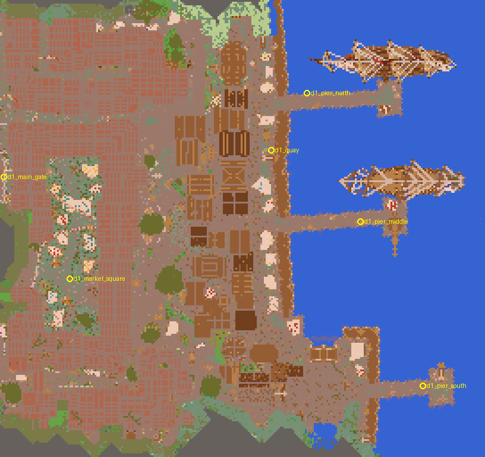

# D1 Harbour export and the workshop loop (Track B1, job 2)

**In short:**
- D1 Harbour is now in the mod's data as **72 vanilla structure templates (32 × 32 columns, 136 high) plus a
  manifest and a terrain mask**: 1,633,687 blocks, 4,298 block entities, **5.1 MB** on disk.
- The town's box is **272 × 256** (17 × 16 chunks), not the survey's 272 × 224. D1's own buildings reach past the
  survey's box on its north and south edges.
- **Round trip:** Drachenfels → templates → pasted by the game → read back matches **100%**: all 1,631,289 source
  blocks the town keeps, and all 4,298 block entities with their data. The 2,398 other stored blocks belonged to
  neighbouring districts and were erased on purpose.
- **Workshop loop:** `workshop.bat` opens a flat sea world with the Harbour in it, and `export-town.bat` writes your
  edits back. An unedited round trip writes byte-identical files. Steps: `tools/buildimport/README.md`, "Editing a
  town".
- Two format traps found and fixed: 26.3 writes block states as `{id, properties}` in both chunks and templates.
  One of them was a bug in the merged survey (see its erratum).

*Template space, north up. Grey strips on the north and south edges are where neighbouring districts' buildings
were erased.*

## 1. What the export holds
| | |
|---|---|
| source | Drachenfels x 128…399, z −1264…−1009 (sea level 66) |
| template box | 272 × 136 × 256; template y 0 = Drachenfels y 5 (a cellar goes that deep) |
| placement | template y 0 at world y 2, so the town's sea (template y 61) lands on our y 63 |
| columns | mold 39,833 · support 6,595 · sea 20,716 · blend 2,488 (of 69,632) |
| blocks | 1,633,687 stored, 1,324,762 not air; 263 distinct block states |
| block entities | 4,298: signs 2,154, chests 723, heads 593, jukeboxes 332, furnaces 167, banners 172, hoppers 64, … |
| entities | none: D1 has none in the save (the save's entity files only hold the 26.3-generated villages around the map) |
| neighbours erased | 136,336 blocks in 6,510 columns (D2 north, D3 west, D8 and D9 south); 2,398 of them were in stored columns |
| waterfront | east, required; quay line at template x 164 (Drachenfels x 292); ~108 blocks of stored sea beyond it |
| markers | 6 seeded: `d1_quay`, `d1_pier_north`, `d1_pier_middle`, `d1_pier_south`, `d1_market_square`, `d1_main_gate` |
| size on disk | templates 5.0 MB, columns 80 kB, manifest 62 kB (its blend edge lists 1,154 columns) |
| export time | ~15 s for the original map, the same for a workshop |

**Size.** 5 MB in the jar is acceptable for v0.1. Loading all 72 tiles at once costs Minecraft's in-memory
`StructureTemplate` form, roughly 1.6 million block infos (~100 MB of heap) while they are held. Phase 3 should load,
place and drop tiles one at a time. If it gets tight later, the alternative is our own palette-packed format read by
our own placer (about a third of the size, and nothing to hold). It is not needed now.

## 2. Decisions made in this job
- **The box grew to 272 × 256** (z −1264…−1009). The survey's 272 × 224 cut a row of D1 houses on the north street
  (they reach z −1255) and the big hall in the south (z −1022). The box is chunk-aligned because the survey's
  rule B is per chunk. The stored area is the full box. Without the boardwalk that runs on into D2, D1's own
  buildings span 272 × 236 (z −1256…−1021). **The planner's footprint needs the same change** (the main session
  was told during the job).
- **Ownership:** each built column belongs to the district of its building, using the survey's building map. Loose
  built columns (walls, lamps, railings) go with the nearest building. Other districts' buildings in the box are
  erased: air, or water below sea level next to open water.
- **Floors per column:** take the lowest of the column's built blocks and its surface-water run (a run whose top is
  at or above sea level − 1), go down to the terrain under that, then 4 more blocks. A cellar column goes down
  with its cellar, a pier column down to the seabed, a street 4 blocks under its paving.
- **Water:** the harbour basin, the open sea inside the box, the piers and the ships are all stored, so the town
  brings its own harbour depth. Generated terrain only meets it at the box's east edge, where Phase 3 blends the
  seabed.
- **Placement contract:** above a stored column's top, air. Below its floor, solid ground (fill down to the first
  solid block). Set blocks without neighbour updates, shape updates or `onPlace`, and ignore waterlogging.
  Without this, rails re-shape, fire goes out and hoppers switch on: 18 blocks differed before the flag was added.
- **Markers** are signs whose first line starts with `@`, or data-mode structure blocks. They are taken out
  before classification, so a marker never makes its column part of the build. The workshop paste puts a sign back
  for every marker, and a sign that shows only the start of a long note keeps the full note on re-export.
- **Re-export is edit-aware:** columns the user didn't touch keep their zone, floor and top exactly. The survey rules
  would otherwise react to the workshop's stand-in ground. Touched columns are re-classified, and a blend column
  joins the town only when something is built on it with placed blocks.
- **Files are deterministic:** palettes are sorted by state name, block-entity keys are sorted, gzip timestamps are
  zero, and an entity's own `block_pos` is stored relative (vanilla rewrites it on placement).

## 3. Round-trip numbers
| check | result |
|---|---|
| game test `townTileLoadsAndPlaces` (tile_7_3, 42,594 blocks, 10 block entities) | every block and block entity as in the file |
| game test `townRoundTrip`: whole town pasted by `TownPaste`, compared in game | 1,633,687 blocks, 0 mismatches; 4,298 block entities, 0 missing, 0 with other data; paste takes ~7 s |
| offline `roundtrip`: that saved paste vs the templates | 1,633,687 blocks, 0 mismatches; block entities 0 missing, 0 differing |
| offline `roundtrip`: that saved paste vs Drachenfels | 1,631,289 blocks, 0 mismatches (100.0000%), plus 2,398 erased on purpose |
| game test `townWorkshopPaste` + re-export from it | all 72 tiles and the columns file byte-identical; markers back at the same places |

Before the palette fix, the first game-test run reported "0 mismatches" because both sides read every palette entry
as air. The tests now also count the non-air blocks the game reads against the manifest, so that can't happen
silently again.

## 4. Building library
`python -m buildimport building <id>`: house **113** (13 × 13, 47 high, 3,247 blocks, 59 block entities, entrance
south, 10 doors) and moored ship **262** (60 × 30, 84 high with its masts, 9,144 blocks), each with a mini
manifest. A library building is cut one block under its lowest built block, so the ship comes without its harbour.

## 5. Known issues
- The workshop world is not in git (`run/` is ignored). Export after each editing session; the templates are the
  backup, and a new workshop can always be made from them.
- In the workshop, digging below a column's floor is not exported (below the town is solid ground by contract).
  Cellars must be built with placed blocks.
- Fluids don't flow in the paste (no updates), just as they stood in the source. Once a player disturbs them in the
  workshop, water at the box edges can spread into the flat sea.
- The survey's building split, door and bed counts were computed with the palette bug (erratum in its report).
  The building map is frozen with the catalog, so ownership and building ids are consistent, but a re-tuned survey
  will renumber buildings.
- Phase 3 is still to do: placing the town in generated worlds, the seabed blend at the east edge, and the
  relief: D1's stored ground spans template y 4–101, cellars included, and the land part climbs ~30 blocks from
  quay to back street.

## 6. Open questions for the user
1. **Marker authoring:** signs with `@name` (readable at a glance, faces a direction), or data-mode structure blocks
   (vanilla's own way, invisible text)? Both work; signs are the recommendation.
2. **The moored ships:** keep them in the Harbour (they're part of its look, built from blocks, 37 "on water"
   pieces including the ships), or take them out of the town and keep them only as library parts?
3. **The box:** 272 × 256 instead of 272 × 224. The planner needs that footprint, or a decision to trim D1.
4. **Licensing** (still open from the survey): shipping Drachenfels' buildings needs the map maker's permission.
