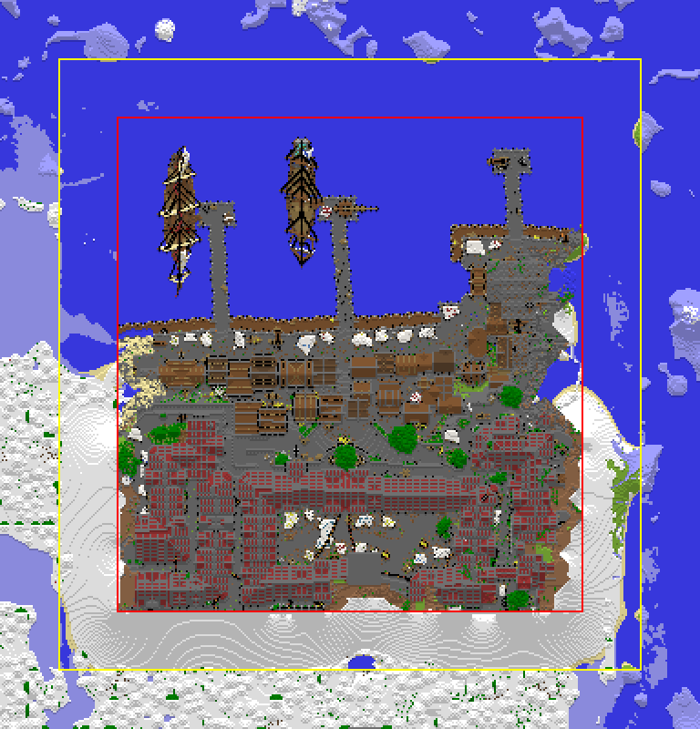
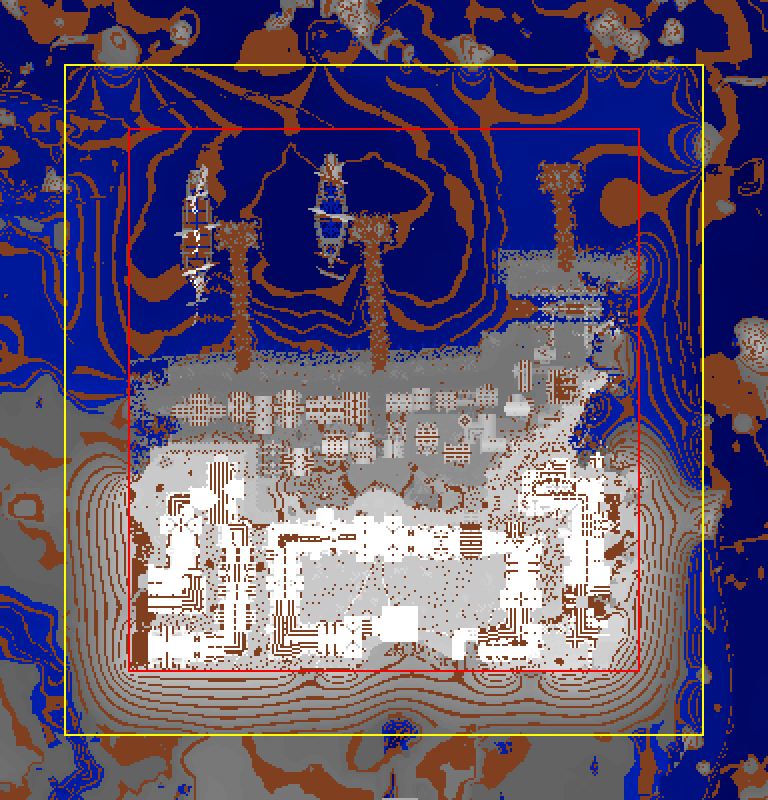

# Phase 3 part 1: the D1 Harbour placed in generated worlds

**In short:**
- Every new RPG world now gets the D1 Harbour at the planner's town site, turned by the plan's rotation.
- The generated terrain is blended up to it.
- Its six markers are saved in the WorldPlan as semantic locations.
- A read-back check of sampled blocks is recorded with it.
- It happens once, during world creation, after pre-generation and before the player can enter.
- On the test seed it adds **16–17 s** to the 164 s of pre-generation.

*Seed 20261029, north up, 2 pixels per block. The Harbour is turned a quarter anticlockwise, so its sea side
(template east) faces north. The ground around it is a snowy biome.*

## 1. How it works

**Mechanism: a controlled paste after pre-generation** (`town/TownPlacement`), not a structure placed during
chunk generation. Reasons:

- The site is per world: it comes from the WorldPlan, not from data-driven structure placement. A worldgen
  structure would need its placement to read runtime state from inside the generator.
- Vanilla's terrain adaptation (the beardifier) reaches about 12 blocks around a piece and only raises or carves
  around it. The Harbour needs more: a 32-block border, a seabed blend at the sea side, and a ~30-block climb from
  quay to back street.
- The export's placement contract (no updates, air above each column, solid ground below) and one-tile-at-a-time
  loading are easy to guarantee in a paste. A structure would put all 72 tiles in vanilla's template cache
  (~100 MB).
- Placing into finished chunks can be checked block by block and resumed step by step.

The cost: the ~500 chunks under the town and its border are generated first and then rewritten, and creation takes
17 s longer. Canon `02` §6 already makes creation the place for this kind of work. The old comment in
`SiteVerifier` ("Phase 3 places builds as the chunks generate") is updated to match.

**When.** At the start of level preparation (`MinecraftServerMixin`), in this order:
1. pre-generation
2. the existing terrain check (`SiteVerifier`), which still measures the natural ground the town replaces
3. placement

**What is placed.** The list is made once, with the WorldPlan, in a new `PlacementState`
(`data/inhabited_world/structure_placement.dat` in the overworld, data version 1). Each site whose catalog ID
names a town in the mod's data gets an entry, pinned to the exact build version found then
(`drachenfels/d1_harbour/v1`). Nothing else ever adds entries, so:

- worlds made before this change are never touched
- a placed town is never placed again on a later load
- the POI (placeholder catalog ID) gets nothing until part 3

**Steps** (each idempotent, so repeating one after a crash gives the same world):

1. **TILES**, one at a time. Load the tile straight from the mod's data (data-fixed, not through vanilla's cache),
   then prepare its stored columns:
   - air above the column's top
   - stone filled below its floor
   - infested blocks turned into plain stone, down to the town region's floor
   - ores within 8 blocks under a floor turned into stone

   Then drop any entity a town may not carry, and place the template turned by the site's rotation, with
   `TownPaste.FLAGS` (no neighbour or shape updates, no `onPlace`) and `IGNORE_WATERLOGGING`. Loot seeds come
   from the world seed and the tile index.
2. **BLEND**. Compute a new ground height for every blend column (`TownBlend`, §2) and rebuild each column that
   moves. Then:
   - remove the generated animals in the site's region
   - let the light engine catch up
   - read back sampled blocks
   - record the placed structure, with its semantic locations, in the WorldPlan
3. **DONE**.

Progress is written only right after a full save of the chunks and then the plan
(`TownPlacement.checkpoint`). A crash can make a step repeat, never skip one. If a build file is missing or
broken, the error is logged and recorded in `PlacementState`, and the world opens without the town. It is not
retried, so a bad file can't stop the world from loading.

**Rotation** (`TownTransform`): vanilla's own template rotation about template (0, 0), plus a shift so that the
turned box fills the site's bounds exactly. Each tile is placed at `S + rotate(offset)`, with `S` the world image
of template (0, 0). Block states turn with `BlockState.rotate`, exactly as vanilla turns any structure. Marker yaw
turns by 90° per clockwise quarter turn.

**Entities.** A template entity is kept only if its type is on an allow-list, which is empty today. Even a listed
type is refused if it is:
- in `inhabited_world:prohibited_human_like` (villagers, wandering traders, zombie villagers, witches, illagers)
- a raider
- in the MONSTER category

Generated animals standing in the site's region are removed after the blend. The test seed had 51 of them,
including 7 polar bears; none were left.

## 2. The terrain blend

Blend columns, 40,376 in all:
- the town's own blend columns inside its box: 2,488, mostly the strips where neighbouring districts were erased
- the 32-block border between the bounds and the region: 37,888

Their new ground is the **harmonic interpolation** (discrete Laplace equation, solved by successive
over-relaxation) between two fixed edges:
- the ground of every stored town column, taken as the median of the stored columns within 2 blocks, so one odd
  column (a pillar footing, a deep wall) doesn't make a spike or a pit
- the generated ground one block outside the region, which placement never changes

A harmonic surface has no peaks or pits of its own, so it can't add a cliff the edges don't already have. It
follows the Harbour's climb along the town's edge, and it blends the seabed at the sea side the same way it blends
land into land. The solve takes 138 sweeps and is part of the 1.7 s blend step.

A column whose ground is already within 1 block of its target is left exactly as generated, plants and trees
included. A changed column gets, from the top down:
- air above it, or water up to the generated sea surface (y 62)
- the surface block: grass on land (snowy, with a snow layer, where the biome is cold enough), sand at the shore
  and on a seabed down to 6 blocks deep, gravel deeper
- 3 blocks of the matching subsoil
- stone filled down through any air or fluid
- the same ore and infested-block cleanup as under the town

**What it looks like** on seed 20261029:
- The inland side (south in the world) rises evenly from the generated ground (y ~65–75) to the town's back
  street (y ~95), about 25 blocks over the 32-block border. That reads as a broad embankment, not a cliff.
- The sea sides meet the generated ocean without a seam in the seabed.
- Raises reach up to 116 blocks and cuts up to 41. The big raises are the town's own blend strips inside the box:
  the template stores those columns as air, so they are refilled from y 2.
- The blended surface is smooth: 33,766 of the 40,376 blend columns step at most 1 block to any neighbour, and
  70 step 7 or more. The steepest step is 15 blocks, counting steps against the town's edge heights. It sits at
  the region's outer edge, where the generated ground is itself steep. Without the edge median, steps reached 26
  blocks on seed 0 (see §5).

## 3. Semantic locations (`02` §16)

The manifest's six markers are resolved through the rotation into world positions and yaws, and saved in the
WorldPlan as part of the placed structure, together with the semantic region at each position.

**WorldPlan data version 5** adds `structures`: a list of placed structures, each with:
- site, catalog ID and exact build
- rotation
- the world position of template (0, 0, 0)
- locations
- the read-back check

The plan checks:
- one structure per site
- the site's own catalog ID and rotation
- location IDs unique across the world
- each location belongs to its structure's site

Plans of versions 1 to 4 read with no placed structures and are written back once as version 5. Nothing is
placed into them.

The read API is `worldstate/SemanticLocations`: `of(server)` or `of(plan)`, then `get(id)`, `all()` and
`ofSite(site)`. It is a view of the plan's structure list, so it works for any number of structures.

Seed 20261029 (town bounds (128, −400) to (383, −129), turned anticlockwise):

| id | world position | faces |
|---|---|---|
| `d1_main_gate` | 227, 102, −131 | north |
| `d1_market_square` | 284, 98, −168 | east |
| `d1_quay` | 212, 71, −281 | north (the sea) |
| `d1_pier_north` | 180, 69, −301 | north |
| `d1_pier_middle` | 252, 70, −331 | north |
| `d1_pier_south` | 344, 69, −366 | north |

The pier names keep the template's compass. In this world the "north" pier is the westernmost.

## 4. Numbers

| | seed 20261029, whole map (`-PgameTestSeed=20261029 -PpregenRows=all`) | seed 0, game tests (14 rows pre-generated) |
|---|---|---|
| site | centre (256, −264), anticlockwise | centre (−64, −264), anticlockwise |
| pre-generation | 7,744 chunks in 164 s | 1,232 chunks in 21–24 s |
| placement total | **15.8–17.3 s** (tiles 13.5 s, blend 1.0–1.7 s, rest: loading 506 chunks, light, checkpoints) | 11.3–14.8 s |
| template blocks placed | 1,633,687 (72 tiles) | same |
| cleared above / filled below | 55,683 / 433,205 | ~110,000 / ~87,000 |
| ores and infested blocks replaced | 5,962 | ~6,300 |
| blend columns / rebuilt | 40,376 / 35,053 | 40,376 / 35,702 |
| steepest step in the blend surface | 15 | 26 (measured before the edge median was added) |
| generated entities removed | 51 (sheep, wolves, polar bears, cows, chickens, rabbits) | ~80 |
| read-back check | **PASSED, 264 of 264** | PASSED, 264 of 264 |
| full comparison (game test) | 1,633,687 blocks, 0 mismatches; 4,298 block entities, 0 missing; 58,871 facing blocks turned right | same |
| water surface | town's stored sea: y 63; generated sea: y 62 | |

Vanilla's own decoration is not bit-for-bit repeatable: two runs of the same seed differ by a few hundred blocks of
trees and ores, and the existing terrain check reports relief 22 one run and 23 the next. Placement is a
deterministic function of the world it finds: the blend reads only the town's data and the ground outside the
region. The game test `repeatingAStepGivesTheSameWorld` re-runs the blend on a finished world and finds 0 columns
to change.

**Tests:**
- 107 unit tests (17 classes), including new tests for:
  - `TownTransformTest`: four rotations, bounds, inverse, tile origins against vanilla's own transform, yaw, and the
    Harbour's markers on the test seed's site
  - `TownBlendTest`: flat, slope, maximum principle, determinism, edge median
  - `PlacementStateTest`
  - `WorldPlanTest`: v5 codec, the plan checks, and migration from v4 (v3 and v2 tests now read into v5)
- 50 game tests, 8 of them new (`TownPlacementGameTests`):
  - the whole placed town against its templates
  - one tile under all four rotations
  - placing again changes nothing
  - repeating a tile or the blend changes nothing
  - markers where the rotation says
  - no entities left in the region
  - a template carrying a villager, zombie, witch and pig places none of them
  - numbers and images

## 5. Known issues

1. **The town's water is 1 block higher than the generated sea.** The town's stored sea tops out at y 63 and
   vanilla's ocean at y 62 (sea level 63 means water up to y 62). The manifest maps template y 0 to world y 2,
   which puts the template's sea surface (y 61) on 63. Along the harbour's sea edges the blend's water is at 62,
   so there is a 1-block water step at the town's box edge. It doesn't flow until something updates it, and then
   a thin sheet runs out over the lower sea.
2. **The town's recorded ground is low along some edges.** On the west edge (template x 0, z 195–207, the cut to
   D3), buildings record their ground ~25 blocks below the street beside them (deep foundations). In the erased
   south strips (template z ~228–248), single columns jump from ~49 to ~93. The 5×5 edge median removes the single
   spikes (steepest step 26 down to 15), but where a whole stretch of the edge is a deep foundation, the blend still
   meets the foundation's foot. The building's lower wall then shows above the slope, like a terrace wall.
3. **The border is mostly rebuilt ground without trees.** 87% of the border columns change by more than a block,
   and a rebuilt column has only grass (or snow), sand or gravel. Trees whose trunk was in a rebuilt column are
   gone. Ones just outside may lose overhanging leaves.
4. **The loading screen holds at 100% for the ~17 s of placement.** Placement doesn't report progress to it.
5. **Not done:** outlining the placed town's own bounds with `/inhabited plan edges`. It needs a change in
   `region/RegionEdges`, which this job was asked not to touch. The existing outline shows the region, 32 blocks
   outside the bounds.
6. **Not caused by this change:** on seed 20261029 with the whole map pre-generated, the existing game test
   `pre_generation_covers_the_map_and_ocean_ring` fails. Ring chunk (−35, −44), at the map's far north-west
   corner, has a floor at y 67 instead of sea. The default build (seed 0) passes.

## 6. Open questions

1. **Water level:** place template y 0 at world y 1 instead of 2, so the harbour's sea meets the ocean flush at
   y 62? The whole town would sit one block lower; it's a one-line `target_sea_level` change in the manifest
   (re-export, or edit `levels`).
   **Recommended: yes.** The 1-block water step is visible on every seed's sea edge.
2. **Deep-foundation edges:** fill those edge stretches with support ground in the workshop, or let a later blend
   tuning read each edge column's lowest open block from the tiles instead of `ground`?
   **Recommended: the blend tuning.** It fixes any district's cut edges without hand edits, and it's a small
   follow-up.
3. **Trees in the border:** replant a few trees on rebuilt land in the border (a deterministic scatter using the
   biome's own tree features), or leave it bare?
   **Recommended: replant**, as a small follow-up once the town is seen in game. It's cosmetic.
